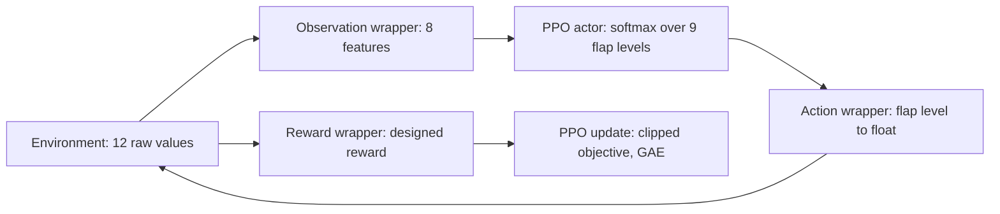
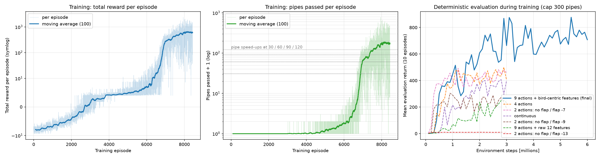
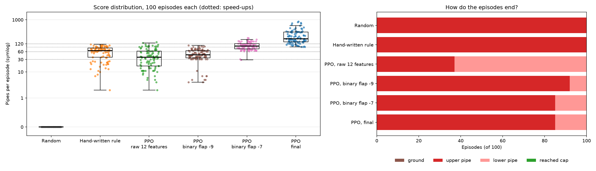

# flappybird-rl-agent

A reinforcement-learning agent that plays a modified Flappy Bird, in which the
pipes **speed up every 30 points** (twice as fast from 120 points) and the
action is a continuous flap strength. The agent is trained with **Proximal
Policy Optimization (PPO)** using a custom reward function, an exact
discretization of the action, and bird-centric observation features.

On 100 unseen episodes it passes **254 pipes on average** (median 188, best
857), never crashes before 90 pipes, and reaches the maximum pipe speed in
85 % of the episodes.

<p align="center"></p>

*The trained agent, first 12 seconds of the [evaluation video](docs/evaluation_video.mp4) (60 s, 51 pipes, no crash).*

## Approach
- **Reward design:** the environment returns no reward, so the agent gets
  +0.1 per step alive, +1 per pipe, −1 for a crash and −0.5 per step above the
  screen, plus potential-based shaping towards the gap centre, which leaves the
  optimal policy unchanged (Ng et al., 1999).
- **Action design:** the flap velocity is `int(-13 · action)` for actions above
  0.5, so the continuous action has exactly 9 distinct effects. The agent
  chooses among these 9 discrete flap levels.
- **Observation design:** 8 features computed from the raw observation: the
  bird's distance and clearances to the next two gaps, its velocity and the
  current pipe speed level, which the raw observation lacks.
- **Algorithm:** PPO (stable-baselines3) with 8 parallel environments,
  6 M training steps (about 30 min on a 24-core CPU).



## Results
Each policy plays the same 100 unseen episodes.

| Policy | Mean ± SD pipes | Median [IQR] | Reaches max speed |
|---|---|---|---|
| Random | 0.0 ± 0.0 | 0 [0–0] | 0 % |
| PPO, raw 12 features | 44.6 ± 32.5 | 36 [17–63] | 2 % |
| PPO, flap / no-flap −9 | 49.4 ± 22.6 | 45 [35–66] | 0 % |
| Hand-written rule | 60.5 ± 28.7 | 65 [37–83] | 0 % |
| PPO, flap / no-flap −7 | 102.5 ± 33.2 | 98 [77–121] | 27 % |
| **PPO, final** | **253.8 ± 168.9** | **188 [143–339]** | **85 %** |

The final agent is significantly better than every other policy (one-sided
Mann–Whitney U, p ≤ 1.1·10⁻²²). All its crashes happen at the two fastest
pipe speeds.





## Repository layout
- [`notebook.ipynb`](notebook.ipynb): the full pipeline (reward, wrappers,
  training, learning curves, evaluation, saving and loading the policy)
- [`agent/`](agent): the trained policy (`flappy_ppo.zip`)
- [`training_logs/`](training_logs): per-episode training logs and periodic evaluations
- [`experiments/`](experiments): logs of the alternative designs compared above
- [`flappy_bird_gymnasium/`](flappy_bird_gymnasium): the modified Flappy Bird
  environment, based on
  [markub3327/flappy-bird-gymnasium](https://github.com/markub3327/flappy-bird-gymnasium)
- [`docs/`](docs): figures and the evaluation video

## Tech stack
- **Python 3.13**, **Gymnasium** for the environment API, **pygame** for rendering
- **stable-baselines3** (PyTorch) for PPO
- **pandas**, **SciPy**, **Matplotlib** for the evaluation and figures

## Quickstart
```bash
git clone https://github.com/AJAYKRISHNAVENKATESAN/flappybird-rl-agent.git
cd flappybird-rl-agent
python -m venv rl_env
source rl_env/bin/activate        # Windows: rl_env\Scripts\activate
pip install -r requirements.txt
jupyter notebook notebook.ipynb
```
The environment needs **NumPy 2.3.5** (pinned in `requirements.txt`): it
converts the action with `int()` on an array, which fails from NumPy 2.4 on.
Do not install the `flappy-bird-gymnasium` package from pip; the notebook
imports the modified environment from the folder next to it.

By default (`TRAIN = False`) the notebook loads the saved agent and runs top
to bottom in about 3 minutes. Set `TRAIN = True` to retrain from scratch.
Without a display (or with `HEADLESS=1`), the rendered demo draws to an
invisible screen instead of opening a window.

## Author
**Ajaykrishna Venkatesan** — [github.com/AJAYKRISHNAVENKATESAN](https://github.com/AJAYKRISHNAVENKATESAN) · aj.grizzy@gmail.com
